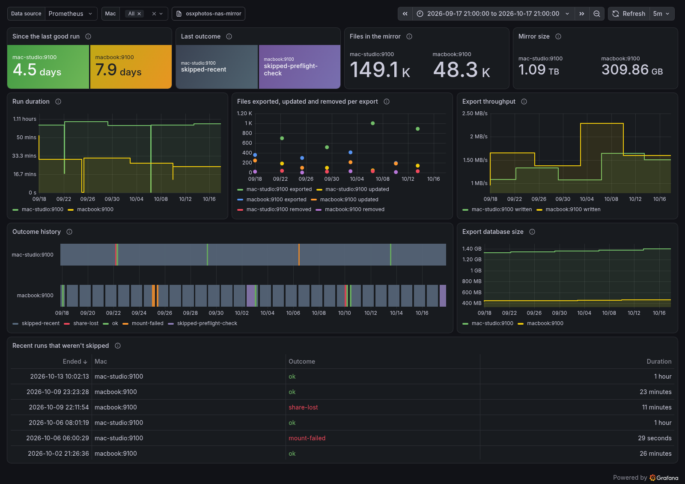

# osxphotos-nas-mirror

Mirrors the Photos library on a Mac to an SMB share on a NAS, using [osxphotos](https://github.com/RhetTbull/osxphotos). It is a weekly mirror: a launchd agent starts it every hour, and the script skips the run unless the last good one finished at least seven full days (7 x 24 hours) ago.

Preflight checks decide whether each run goes ahead. One of the example preflight checks, the dock check, lets a run start only while the Mac is plugged into a given Ethernet dock, identified by the dock's MAC address. That keeps a laptop from running away from home.

The share holds a mirror of the library, not a backup on its own. A backup also needs an archive, the history of the mirror, which you build outside this tool (see `docs/adr/0004-the-share-is-a-mirror.md`).

## How it works

* The source is the local Photos library (the System Library).
* The destination is the share, mounted the way Finder mounts it, under `/Volumes` (usually `/Volumes/photos`; see `docs/adr/0001-mount-the-share-as-finder-does.md`).
* osxphotos does the export, from a private Python in the app under launchd and through `uv` from a checkout, AppleScript's `mount volume` does the mount, and `launchd` does the scheduling.
* The osxphotos export database stays on the Mac's SSD in `~/Library/Application Support/osxphotos-nas-mirror/`. After each successful run the script copies it to the share as `.osxphotos_export.db`.

## Files

| File | Purpose |
|---|---|
| `osxphotos-nas-mirror.sh` | The mirror script: preflight checks, mount, export, database copy. |
| `osxphotos-nas-mirror.conf.example` | The settings, with placeholder NAS details. Copy it to the app directory as `osxphotos-nas-mirror.conf`; the script sources that copy. |
| `osxphotos.toml` | The osxphotos export options the script loads. |
| `preflight-checks/dock-connected.sh` | The dock check, one of the example preflight checks. `dock-connected.sh MAC` exits 0 if that MAC address appears in `ifconfig -a`, 1 if not, 2 if given no address. |
| `preflight-checks/network-path.sh` | Skips the run on a hotspot or cellular connection, in Low Data Mode, or offline. Runs `network-path.swift` with `swift`, so it needs the Xcode command line tools. |
| `preflight-checks/download-speed.sh` | `download-speed.sh MIN_MBIT` skips the run if `networkQuality` measures the download below MIN_MBIT. Each test moves a few hundred MB (about 215 MB in the fixture), so list it after `network-path.sh` and it won't run on a hotspot. With the weekly gate it runs at most once an hour, and only while the gate is open. A run downloads missing originals from iCloud, and `networkQuality` measures the path to Apple's servers, so this covers the iCloud side. `nas-rtt.sh` covers the NAS side. |
| `preflight-checks/nas-rtt.sh` | `nas-rtt.sh HOST MAX_MS` skips the run unless HOST answers a ping with an average round trip of at most MAX_MS. Suits a NAS on the home LAN. |
| `examples/osxphotos-exif.toml` | An alternative config that also writes metadata with exiftool, XMP sidecars and Finder tags. The script doesn't use it; point `OSXPHOTOS_CONFIG` at a copy to use it. |
| `examples/grafana-dashboard.json` | An example Grafana dashboard for the metrics (see "Example dashboard"). |
| `launchd/io.github.timjdfletcher.osxphotos-nas-mirror.plist.template` | The launchd agent that runs the app, with a `@HOME@` placeholder that `make install` fills in. |
| `launchd/build-app.sh`, `launchd/runner.c`, `launchd/Info.plist` | What `make app` builds the app from (see Automation). |

## Prerequisites

1.  A Mac running macOS, with Photos set to "Download Originals" or able to download them on demand (the config sets `download_missing`).
2.  `uv` and `git`, to build the app or run from a checkout. Install uv with `brew install uv`; git comes with the Xcode command line tools. The script runs osxphotos through uv, as `uvx --python 3.13 --from git+https://github.com/TimJDFletcher/osxphotos@<tag> osxphotos`, so osxphotos gets its own Python environment. uv clones and builds it on the first run, which takes a while. Homebrew's osxphotos formula doesn't work for this: it broke when Homebrew's `cffi` dropped Python 3.13 (`No module named '_cffi_backend'`).

    The default osxphotos source is a pinned tag of the author's fork, which fixes two bugs in 0.77.2 (see `docs/adr/0003-run-osxphotos-through-uvx-from-a-pinned-source.md`). `OSXPHOTOS_SOURCE` in the conf overrides it, for example with `osxphotos==0.77.2` from PyPI.
3.  A Samba server with the macOS VFS modules enabled. In `smb.conf`:
    ```ini
    [global]
    vfs objects = catia fruit streams_xattr
    fruit:metadata = stream
    fruit:encoding = native
    fruit:resource = xattr
    fruit:aapl = yes
    server min protocol = SMB2
    ```
    The share must be writable by the SMB user. The author's share also sets `inherit permissions = Yes`, which fixed a "Permission denied" (code 513) where osxphotos could create folders but not write files in them. Samba's default `case sensitive = auto` makes the share case-insensitive to SMB2 clients, which osxphotos' `--cleanup` expects, even on a case-sensitive filesystem.

## Setup

1.  Clone this repo:
    ```bash
    git clone https://github.com/TimJDFletcher/osxphotos-nas-mirror.git
    cd osxphotos-nas-mirror
    ```

2.  Copy the example conf to the app directory and edit it. The real conf isn't in the repo (`*.conf` is gitignored):
    ```bash
    mkdir -p ~/Library/Application\ Support/osxphotos-nas-mirror
    cp osxphotos-nas-mirror.conf.example ~/Library/Application\ Support/osxphotos-nas-mirror/osxphotos-nas-mirror.conf
    ```
    `OSXPHOTOS_NAS_MIRROR_CONF` overrides the path. The settings you will change:
    * `NAS_USER`, `NAS_HOSTNAME`, `NAS_SHARE`: the SMB user, server and share.
    * `MOUNT_TIMEOUT`: seconds to wait for the share to mount (default 60).
    * `SHARE_CHECK_INTERVAL`: seconds between checks that the share is still mounted while osxphotos exports (default 5).
    * `MIRROR_INTERVAL_DAYS` (optional): the least number of days between good runs (default 7). It counts whole 24-hour periods from the last good run, not calendar days: the gate opens when that run is `MIRROR_INTERVAL_DAYS` x 24 hours old, and the next hourly start after that runs. 0 runs every time the agent starts it.
    * `PREFLIGHT_CHECKS` (optional): a bash array of strings, one per check, run in order before anything is mounted. Each string is split on whitespace into a command and its arguments, so an argument can't contain a space. The first check that doesn't exit 0 decides and later ones don't run: exit 1 ends the run `skipped-preflight-check`, and any other code ends it `preflight-check-failed`. If every check exits 0 the run goes ahead. A command path containing a `/` that isn't absolute is relative to the script's directory. Unset or empty, every run goes ahead. For example, `PREFLIGHT_CHECKS=("preflight-checks/network-path.sh" "preflight-checks/download-speed.sh 50")`. For the dock check, use the MAC address of the dock's Ethernet adapter, found in `ifconfig -a` while docked: `PREFLIGHT_CHECKS=("preflight-checks/dock-connected.sh aa:bb:cc:dd:ee:ff")`.
    * `OSXPHOTOS_SOURCE` (optional): what `uvx --from` installs osxphotos from, such as `osxphotos==0.77.2` or `git+https://...@<tag>`. Unset, the script's pinned default is used. Python stays 3.13.
    * `OSXPHOTOS_CONFIG` (optional): the osxphotos TOML to load. Unset, the repo's `osxphotos.toml`.
    * `LOCK_FILE` (optional): the run lock's file (see "Outcomes", `skipped-locked`). Unset, `run.lock` in the app directory. It must be an absolute path, or the run ends `usage-error`.
    * `METRICS_TEXTFILE` (optional): a Prometheus textfile for node_exporter, written at the end of every run (see "Metrics"). Unset, no metrics. It must be an absolute path; a relative one is logged as a warning and no textfile is written, and the outcome doesn't change.

    On a laptop, set a preflight check. `nas-rtt.sh` needs no MAC address and no swift; use the dock check if you dock. Without one, every hourly attempt away from home, once the weekly gate opens, ends `mount-failed` with a notification.

    The example also sets `NOTIFY_TIMEOUT`, `APP_DIR`, `LOG_FILE` and `OSXPHOTOS_EXPORT_DB`. The defaults are fine.

3.  Save the SMB password the Finder way. In Finder choose Go > Connect to Server, enter `smb://NAS_USER@NAS_HOSTNAME/NAS_SHARE` with your values from the conf, type the password and tick "Remember this password in my keychain". Each run checks the login keychain before mounting and ends in `no-credentials` if there is no entry, so a run never raises a password dialog.

4.  Give your terminal app Full Disk Access, for runs by hand: System Settings > Privacy & Security > Full Disk Access. Runs by launchd don't use it: they run as an app, and macOS asks you to allow that app what it needs (see Automation). Don't add `/bin/bash` instead, because that gives Full Disk Access to anything run as a bash script.

5.  Run it once by hand with `--force` (see Usage). The first run mirrors the whole library, so it takes a long time.

6.  Install the launchd agent (see Automation).

## Usage

First run, or any run started by hand:
```bash
./osxphotos-nas-mirror.sh --force
```

What launchd runs:
```bash
~/Applications/osxphotos-nas-mirror.app/Contents/MacOS/osxphotos-nas-mirror
```

The script takes at most one flag:

* `--force` skips the recency gate and every preflight check. Use it for a run you start by hand, such as the first one, or one soon after a good run.
* `--skip-preflight-check` skips only the preflight checks; the recency gate still applies.

Without a flag, the script first checks the stamp (see Automation), then runs the conf's `PREFLIGHT_CHECKS` in order. If one exits 1, as the dock check does when the dock is absent, the run ends quietly and the later ones don't run.

### Logs

A run writes to two places in the app directory:

* The run log, `osxphotos-nas-mirror.log` (`LOG_FILE`): the script's own lines, the output of the preflight checks and the mount, and, for a run that exports, a line naming its export log and osxphotos' closing summary (`Processed: N photos, exported: N, updated: N, skipped: N, ... error: N, ...` and `Deleted: N files, N directories`), or a line saying osxphotos printed none. Each run ends with its `outcome=` line. The script trims it to its last 10,000 lines at the end of each run, except a run that ends `skipped-locked`: the run holding the lock may still be writing to it, and trims it when it ends.
* The export logs, in `exports/`: osxphotos' own output for one run, a line or two per photo (`osxphotos.toml` sets `verbose = true`), named after the run's start time, such as `exports/2026-10-25T00-00-12.log`. Only a run that gets as far as exporting writes one. Before it does, it deletes the oldest, so the 8 newest are kept.

Follow a run live in the run log, and an export in the newest export log:
```bash
cd "$HOME/Library/Application Support/osxphotos-nas-mirror"
tail -f osxphotos-nas-mirror.log
tail -f "exports/$(ls exports | tail -n 1)"
```

An existing install needs nothing done: its next run trims the old run log, which held osxphotos' output too, down to 10,000 lines.

### Metrics

With `METRICS_TEXTFILE` set in the conf, every run ends by writing that file in Prometheus text format, for [node_exporter](https://github.com/prometheus/node_exporter)'s textfile collector. Point the collector at the file's directory and give the file a name ending `.prom`, for example:

```bash
node_exporter --collector.textfile.directory=/opt/homebrew/var/node_exporter/textfile
```
```bash
METRICS_TEXTFILE="/opt/homebrew/var/node_exporter/textfile/osxphotos_nas_mirror.prom"
```

(Homebrew's `node_exporter` service takes its flags from `$(brew --prefix)/etc/node_exporter.args`.) The script writes the whole file to a temp file beside it, named `….prom.<pid>.tmp`, which the collector ignores, then renames it over the old one, so node_exporter never reads half a file. If it can't, the run logs a warning before its outcome line, removes the temp file, and its outcome and exit code don't change.

Every metric is a gauge with `# HELP` and `# TYPE` lines, named with the prefix `osxphotos_nas_mirror_`:

| Metric | Meaning | Updated by |
|---|---|---|
| `last_run_timestamp_seconds` | When the last run ended (Unix time). | every run |
| `last_run_outcome{outcome="…"}` | One series for each outcome in the table under "Outcomes": 1 for the outcome the last run ended with, 0 for the others. | every run |
| `last_ok_timestamp_seconds` | The `last-ok` stamp's mtime: when the last `ok` run ended. Left out while there is no stamp. | every run |
| `export_db_bytes` | The export database's size. | every run |
| `last_run_duration_seconds` | How long the run took. | every run that isn't skipped (`skipped-*`) |
| `last_export_timestamp_seconds`, `last_export_duration_seconds` | When the export ended, and how long it took. | every run whose export printed osxphotos' summary |
| `last_export_photos` | Photos processed, from osxphotos' summary line. | the same |
| `last_export_files{result="…"}` | Files `exported` (new), `updated`, `skipped` (up to date), `missing` and `error`, from the summary line. | the same |
| `last_export_deleted_files` | Files cleanup deleted from the share, from the `Deleted: N files` line. | the same |
| `mirror_files`, `mirror_bytes` | The files on the share and their size (see below). | every `ok` run |
| `last_export_bytes` | Bytes the export wrote: the size of its new and updated files. | every `ok` run |

A run that doesn't update a metric carries its last value over from the file as it was, so a `skipped-recent` run changes only the run timestamp, the outcome series, the stamp and the database size, and the export's counts stay those of the last export that printed its summary.

`mirror_files` and `mirror_bytes` come from the export database, read with the system `sqlite3` (opened `immutable`, which is read-only) after the export, not from the share (no `du` or `find` over SMB). They count the files this run's export wrote or found up to date, which are the files cleanup leaves on the share, and add up their sizes as osxphotos recorded them when it last wrote each one. They leave out files cleanup deleted and photos gone from the library, which stay in the database for good. They also miss some files cleanup keeps: a file osxphotos reported missing this run that an earlier run left on the share, a file whose export failed (the summary's `error` count), and sidecars, if your osxphotos config writes them (osxphotos records no history for sidecars). Files you put on the share yourself aren't counted either. `osxphotos-nas-mirror.sh` (`mirror_from_export_db`) has the details.

Two example alerting rules:

```yaml
- alert: PhotosMirrorStale
  # No ok run for 8 days (the gate allows one every 7).
  expr: time() - osxphotos_nas_mirror_last_ok_timestamp_seconds > 8 * 86400
- alert: PhotosMirrorFailed
  # The last run ended with an outcome that exits non-zero.
  expr: max(osxphotos_nas_mirror_last_run_outcome{outcome!~"ok|skipped-.*"}) == 1
```

The first doesn't fire while there's no stamp at all; add `absent(osxphotos_nas_mirror_last_ok_timestamp_seconds)` if that should alert too.

### Example dashboard

`examples/grafana-dashboard.json` is a Grafana dashboard for these metrics. Import it (Dashboards > New > Import) and pick a Prometheus data source. It names no data source and no Mac, so it needs no editing; the Mac drop-down picks which `instance`s it shows.



It shows the last 30 days on one screen. The top row has the time since the last good run (green under 7 days, the gap the recency gate allows, amber to 8, red after), each Mac's last outcome, and the files and bytes in the mirror. Below that are the run duration, the files each export wrote, updated and removed, and the bytes it wrote a second; then the outcome history beside the export database's size; and last, the runs in the time range that weren't skipped.

The outcome history shows the most notable outcome in each interval on screen, a failure over ok and ok over a skip, so a run that ended minutes before the next skipped one still shows. The screenshot is of made-up data: five weeks of hourly runs from a Mac that stays at home and a laptop that sleeps at night and is away some days.

## Automation

The launchd agent starts the script on the hour, every hour (`StartCalendarInterval`, `Minute` 0), so a Mac that is home at any hour is caught. A LaunchAgent runs only while you are logged in and the Mac is awake. Hourly runs missed while it slept coalesce into one run on wake.

The script makes that weekly. A run that ends `ok` touches `last-ok` in the app directory. Until that file is `MIRROR_INTERVAL_DAYS` x 24 hours old (default 7 days, so 168 hours), a run ends `skipped-recent`, before the preflight checks, so a costly check such as `download-speed.sh` doesn't run while the gate is shut. Once it opens, a check that skips the run is tried again each hour. With no `last-ok` the run goes ahead. Only `ok` writes it: a failed or skipped run is tried again at the next hour. A preflight check such as the dock check makes runs a no-op away from home.

```bash
make app
make install
launchctl load ~/Library/LaunchAgents/io.github.timjdfletcher.osxphotos-nas-mirror.plist
launchctl list | grep io.github.timjdfletcher.osxphotos-nas-mirror
```

The agent runs `osxphotos-nas-mirror.app`, not the script in your checkout. The app holds the script, `osxphotos.toml`, the preflight checks, and a private Python with osxphotos for Apple Silicon, so a run needs no uv or Homebrew. `network-path.sh` still needs the Xcode command line tools for `swift`. In the conf, name preflight checks by relative path, such as `preflight-checks/dock-connected.sh`, so they resolve inside the app. An absolute path into a checkout also works, but runs code outside the signed app.

Be at the Mac for the first run launchd starts, and allow what macOS asks for, which is access to the Photos library and to network volumes. Without the app macOS doesn't ask: it refuses `/bin/bash` silently, and the run ends `db-copy-failed` with `Operation not permitted`, then runs again every hour because only an `ok` run touches `last-ok`.

`make app` signs the app with the certificate `osxphotos-nas-mirror local signing` in your keychain, or `SIGN_IDENTITY` if set, and macOS ties the permissions to that certificate. Build every update with the same one and it keeps them; a new certificate means allowing the prompts again. To make one, create a self-signed certificate with the Code Signing extended key usage, for example in Keychain Access > Certificate Assistant. `make package` zips the app for release.

To update, run `make app` and `make install`, or `make install APP=/path/to/the/unpacked.app`. `make install` copies the app to `~/Applications`, fills in the template with your home directory and copies the result to `~/Library/LaunchAgents/`. It doesn't run `launchctl`; it prints the `load` command. An update to the app needs no reload, but a changed plist does: `launchctl unload` and `launchctl load` it, because launchd keeps the copy it loaded. stdout goes to `/dev/null` because the script already writes each line to the run log; stderr goes to the run log.

Neither log grows without bound (see "Logs"), so nothing needs to rotate them.

## Outcomes

Every run ends with one `outcome=<name>` line as the last line of the run log, and exits with that outcome's code (from `sysexits.h`):

| Outcome | Exit | Meaning |
|---|---|---|
| `ok` | 0 | Exported, and the export database was copied to the share. |
| `skipped-preflight-check` | 0 | A preflight check exited 1: this run is not wanted (for the dock check, the dock is absent). The run log names the check. Later checks did not run. Nothing was mounted or exported. |
| `skipped-recent` | 0 | The last good run was less than `MIRROR_INTERVAL_DAYS` x 24 hours ago (see Automation). The run log says when. Nothing was mounted or exported, and the preflight checks did not run. `--force` bypasses this. |
| `skipped-locked` | 0 | Another run, or the export of one, was still in progress. A run holds a kernel lock (`flock`) on `LOCK_FILE` (by default `run.lock` in the app directory), and osxphotos inherits it, so the lock stays held while the export runs, even if the script that started it was killed. The lock ends when its last holder exits, so a lock file left behind never blocks a run. Nothing was mounted or exported. |
| `usage-error` | 64 | An unknown argument, a `MIRROR_INTERVAL_DAYS` that is not a whole number, or a conf that is missing, unreadable, fails to load, or leaves a setting unset, or a `LOCK_FILE` that is not an absolute path or can't be opened or locked. Nothing was mounted or exported. |
| `mount-failed` | 69 | The share was not mounted after trying to mount it. |
| `share-lost` | 69 | The share stopped being mounted during the export or before the database copy. osxphotos was stopped and the database was not copied. |
| `preflight-check-failed` | 70 | A preflight check exited 2 or more, or could not be run (bash's 126 and 127). The run log names the check and the code. Later checks did not run. Nothing was mounted or exported. |
| `export-failed` | 70 | `osxphotos export` exited non-zero. Its export log says why. The export database was not copied to the share. |
| `db-copy-failed` | 74 | The export succeeded, but copying the export database to the share failed. |
| `interrupted` | 75 | The run was stopped by SIGTERM (as launchd sends when the agent is unloaded or you log out), SIGINT (Ctrl-C) or SIGHUP. osxphotos was stopped and the export database was not copied. The next run picks up where this one stopped. A stop that arrives during a preflight check or a mount attempt takes effect once that ends. |
| `no-credentials` | 78 | The share needed mounting, but the login keychain has no SMB password for `NAS_USER` at `NAS_HOSTNAME`. Nothing was mounted or exported. Connect to the share once in Finder and tick "Remember this password in my keychain". |

Every outcome with a non-zero exit code also posts a macOS notification titled "osxphotos NAS mirror", `Mirror run failed: <outcome>. See <log>.`, through `osascript`. `export-failed`, `share-lost` and `interrupted` name the export log of the export that ended the run, which explains it (an `interrupted` run stopped before its export names the run log). The others name the run log, or, with no run log, point to the run's error output. `ok`, `skipped-preflight-check`, `skipped-recent` and `skipped-locked` post none. If the notification can't be posted, or `osascript` takes longer than `NOTIFY_TIMEOUT` seconds (conf, default 10), the run logs a warning and its outcome is unchanged.

When the conf is missing or unreadable, or leaves a setting unset, the run's lines, including the outcome, go to stderr instead of the run log.

### Checking notifications

The tests stub `osascript`, so they can't show that macOS displays a notification posted from a LaunchAgent, and `osascript` exits 0 even when macOS suppresses one. Check by hand, logged in at the Mac:

```bash
launchctl submit -l io.github.timjdfletcher.osxphotos-nas-mirror.notify-test -- /bin/sh -c \
  '/usr/bin/osascript -e "display notification \"LaunchAgent test\" with title \"osxphotos NAS mirror\""; launchctl remove io.github.timjdfletcher.osxphotos-nas-mirror.notify-test'
```

A "LaunchAgent test" notification should appear once. `launchctl submit` restarts a job each time it exits, so this one removes itself after posting. If notifications keep coming, run `launchctl remove io.github.timjdfletcher.osxphotos-nas-mirror.notify-test`. If it doesn't, check System Settings > Notifications for Script Editor, which macOS shows as the sender of `osascript` notifications, and allow it.

## Tests

```bash
make test    # shellcheck, plutil and jq, then the fixture tests and the make install test
```

`make lint` checks the example dashboard with jq (`tests/grafana-dashboard.sh`): it must parse, have no uid of its own, take its data source and Macs from the `datasource` and `instance` variables, and hard-code neither. It must also query only metrics the script writes, and its outcome codes must cover exactly the outcomes in `OUTCOMES`; the check reads both from `osxphotos-nas-mirror.sh`.

`tests/mirror-run.sh` runs `osxphotos-nas-mirror.sh` as a process against a test conf (`OSXPHOTOS_NAS_MIRROR_CONF`) and stub `mount`, `uvx`, `osascript` and `security` on `PATH` (`osascript` stands in for both notifications and the mount), and stub preflight check scripts for each exit path and for several checks in a row, so no test touches the dock, the share or the Photos library. The example dock check is run as a process too, with a stub `ifconfig`. The metrics cases build an export database with `sqlite3` from the schema in `tests/fixtures/`, and check the textfile with `promtool check metrics` when it is on `PATH`, otherwise with a format check of their own. `tests/install.sh` runs `make install` with `HOME` set to a temporary directory and checks the plist it writes.

## Behaviour to know about

* The mirror follows deletions. `osxphotos.toml` sets `cleanup = true`, so a photo deleted from the library is deleted from the share on the next run.
* Updates are incremental. `update = true` exports only new or changed photos, using the export database. Keep that database: without it, osxphotos re-exports everything.
* The script passes `--newest-first`, so recent photos are mirrored first.

## License

GPL-3.0-or-later. Copyright (C) 2026 Tim Fletcher. See `LICENSE`.

## Issues

The backlog is on GitHub: [TimJDFletcher/osxphotos-nas-mirror issues](https://github.com/TimJDFletcher/osxphotos-nas-mirror/issues).
