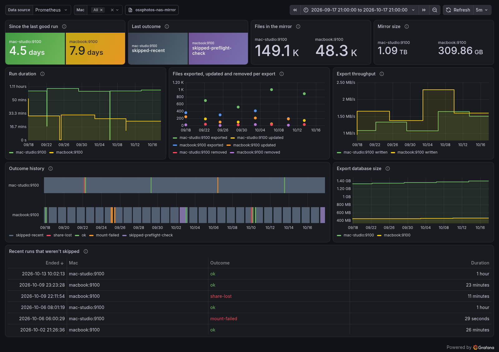

# osxphotos-nas-mirror

A macOS app that mirrors the Photos library on a Mac to an SMB share on a NAS, once a week, with nobody at the Mac. A launchd agent starts the app every hour. The app skips the run unless the last good run ended at least 7 x 24 hours ago, so the mirror is weekly. Preflight checks decide whether each run goes ahead: the dock check, for example, lets a laptop run only while it is plugged into a given Ethernet dock.

The app holds everything a run needs: the mirror script, its config, the preflight checks, and a private Python with [osxphotos](https://github.com/RhetTbull/osxphotos), which does the export. A run needs no Homebrew, no uv and no checkout. You build the app once, sign it with your own certificate, and allow it access to the Photos library and network volumes once.

It has to be an app. launchd can start a shell script, but macOS refuses `/bin/bash` access to the Photos library and network volumes without asking. macOS asks once on behalf of an app, and the grant follows the app's signing certificate across updates (`docs/adr/0007-launchd-runs-a-self-contained-app.md`).

The share holds a mirror of the library, not a backup on its own. A backup also needs an archive, the history of the mirror, which you build outside this tool (`docs/adr/0004-the-share-is-a-mirror.md`).

## How a run works

1. launchd starts the app on the hour. The app runs the script inside it and passes on its exit code.
2. The script reads the conf, takes the run lock, and ends `skipped-recent` if the last `ok` run is too recent.
3. It runs the preflight checks in order. The first check that doesn't exit 0 ends the run.
4. It checks that the login keychain holds the SMB password, then mounts the share under `/Volumes` the way Finder does (`docs/adr/0001-mount-the-share-as-finder-does.md`).
5. osxphotos exports the library to the share, newest photos first. The export database on the Mac's SSD says what is already there, so only new and changed photos are written. While osxphotos runs, the script checks every few seconds that the share is still mounted.
6. The script copies the export database to the share as `.osxphotos_export.db`.
7. The run ends with an outcome. A failure posts a macOS notification. If you set up metrics, the run writes them for node_exporter.

The mirror follows deletions. `osxphotos.toml` sets `cleanup = true`, so a photo deleted from the library is deleted from the share on the next run. Keep the export database in `~/Library/Application Support/osxphotos-nas-mirror/`: without it, osxphotos exports everything again.

## Prerequisites

1.  A Mac with Apple Silicon. The app holds Apple Silicon binaries only. Set Photos to "Download Originals", or let it download them on demand: the config sets `download_missing`.
2.  To build the app: the Xcode command line tools (`xcode-select --install`), for `git` and `clang`, and uv (`brew install uv`). The `network-path.sh` preflight check also needs the command line tools at run time, for `swift`.
3.  A Samba server with the macOS VFS modules enabled. In `smb.conf`:
    ```ini
    [global]
    vfs objects = catia fruit streams_xattr
    fruit:metadata = stream
    fruit:encoding = native
    fruit:resource = xattr
    fruit:aapl = yes
    server min protocol = SMB2
    ```
    The share must be writable by the SMB user. The author's share also sets `inherit permissions = Yes`. That fixed a "Permission denied" (code 513), where osxphotos could create folders but not write files in them. osxphotos' `--cleanup` expects the share to be case-insensitive to SMB2 clients. Samba's default, `case sensitive = auto`, gives that even on a case-sensitive filesystem.

## Install

1.  Clone this repo:
    ```bash
    git clone https://github.com/TimJDFletcher/osxphotos-nas-mirror.git
    cd osxphotos-nas-mirror
    ```

2.  Create the signing certificate. In Keychain Access, choose Certificate Assistant > Create a Certificate, name it `osxphotos-nas-mirror local signing`, and make it a self-signed certificate for Code Signing. To use a certificate with another name, set `SIGN_IDENTITY` when you run `make app`. macOS ties the app's permissions to this certificate, so sign every update with the same one. A new certificate means you allow the prompts again.

3.  Build the app and install it with the launchd agent:
    ```bash
    make app
    make install
    ```
    `make app` builds `build/osxphotos-nas-mirror.app`. `make install` copies it to `~/Applications`, writes the agent's plist to `~/Library/LaunchAgents/`, and prints the `launchctl load` command. It doesn't load the agent.

4.  Copy the example conf to the app directory, then set `NAS_USER`, `NAS_HOSTNAME` and `NAS_SHARE` in it:
    ```bash
    mkdir -p ~/Library/Application\ Support/osxphotos-nas-mirror
    cp osxphotos-nas-mirror.conf.example ~/Library/Application\ Support/osxphotos-nas-mirror/osxphotos-nas-mirror.conf
    ```
    On a laptop, also set a preflight check. Without one, every hourly run away from home, once the weekly gate opens, ends `mount-failed` with a notification. `nas-rtt.sh` needs no MAC address and no `swift`. Use the dock check if you dock. "Settings" lists the rest.

5.  Save the SMB password in your keychain. In Finder, choose Go > Connect to Server, enter `smb://NAS_USER@NAS_HOSTNAME/NAS_SHARE` with your values, type the password, and tick "Remember this password in my keychain". Each run checks the keychain before it mounts the share, and ends `no-credentials` if the password isn't there. A run never shows a password dialog.

6.  At the Mac, open `osxphotos-nas-mirror` from `~/Applications`. It has no window: it does a normal run, preflight checks included. Allow what macOS asks for, which is access to the Photos library and to network volumes. The first run mirrors the whole library, so it takes a long time. Follow it in the logs (see "Logs").

7.  Load the agent and check that launchd has it:
    ```bash
    launchctl load ~/Library/LaunchAgents/io.github.timjdfletcher.osxphotos-nas-mirror.plist
    launchctl list | grep io.github.timjdfletcher.osxphotos-nas-mirror
    ```

If you skip step 6, the first run under launchd can't ask for access. macOS refuses it silently, the run ends `db-copy-failed` with `Operation not permitted`, and it fails again every hour until you open the app.

## Update the app

Pull, then build and install again:
```bash
git pull
make app
make install
```

Runs use the app's copy of the script, its config and osxphotos, not your checkout. A change in the checkout, including a new osxphotos version, reaches runs only once you build and install the app again. To install an app that was built elsewhere and unpacked, run `make install APP=/path/to/osxphotos-nas-mirror.app`.

A new app needs no reload. A changed plist does, because launchd keeps the copy it loaded: run `launchctl unload` and then `launchctl load` on it.

## Settings

The conf is `~/Library/Application Support/osxphotos-nas-mirror/osxphotos-nas-mirror.conf`, a bash file the script sources. `OSXPHOTOS_NAS_MIRROR_CONF` overrides the path. The conf isn't in the repo (`*.conf` is gitignored).

* `NAS_USER`, `NAS_HOSTNAME`, `NAS_SHARE`: the SMB user, server and share.
* `MOUNT_TIMEOUT`: seconds to wait for the share to mount (default 60).
* `SHARE_CHECK_INTERVAL`: seconds between checks that the share is still mounted while osxphotos exports (default 5).
* `MIRROR_INTERVAL_DAYS` (optional): the least number of days between good runs (default 7). See "When runs happen". 0 runs every time the agent starts the app.
* `PREFLIGHT_CHECKS` (optional): a bash array of strings, one per check. See "Preflight checks". Unset or empty, every run goes ahead.
* `OSXPHOTOS_CONFIG` (optional): the osxphotos TOML to load. Unset, it is the app's copy of `osxphotos.toml`.
* `LOCK_FILE` (optional): the run lock's file (see `skipped-locked` under "Outcomes"). Unset, it is `run.lock` in the app directory. It must be an absolute path, or the run ends `usage-error`.
* `METRICS_TEXTFILE` (optional): a Prometheus textfile for node_exporter, written at the end of every run (see "Metrics"). Unset, the run writes no metrics. It must be an absolute path. With a relative one, the run logs a warning and writes no textfile, and the outcome doesn't change.
* `OSXPHOTOS_SOURCE` (optional): leave it unset. It makes the script run osxphotos through `uvx`, which the app doesn't have and launchd's `PATH` doesn't reach. See "Run from a checkout".

The example also sets `NOTIFY_TIMEOUT`, `APP_DIR`, `LOG_FILE` and `OSXPHOTOS_EXPORT_DB`. Their defaults are fine.

### Preflight checks

The checks run in order, before anything is mounted. The script splits each string on whitespace into a command and its arguments, so an argument can't contain a space. A command path that contains a `/` and isn't absolute is relative to the script's directory, which in the app is inside the app. Name the checks that way, such as `preflight-checks/dock-connected.sh`. An absolute path into a checkout also works, but it runs code outside the signed app.

The first check that doesn't exit 0 decides, and later checks don't run. Exit 1 ends the run `skipped-preflight-check`, quietly. Any other code ends it `preflight-check-failed`, with a notification.

The app holds four example checks:

| Check | Skips the run when |
|---|---|
| `preflight-checks/dock-connected.sh MAC` | The dock's MAC address isn't in `networksetup -listallhardwareports`. Find the address of the dock's Ethernet adapter there while docked. With no address it exits 2. |
| `preflight-checks/network-path.sh` | The Mac is on a hotspot or a cellular connection, is in Low Data Mode, or is offline. It runs `network-path.swift` with `swift`, so it needs the Xcode command line tools. |
| `preflight-checks/download-speed.sh MIN_MBIT` | `networkQuality` measures the download below MIN_MBIT. It measures the path to Apple's servers, which is where a run downloads missing originals from iCloud. Each test moves a few hundred MB, so list it after `network-path.sh` to keep it off a hotspot. |
| `preflight-checks/nas-rtt.sh HOST MAX_MS` | HOST doesn't answer a ping with an average round trip of at most MAX_MS. It suits a NAS on the home LAN. |

For example:
```bash
PREFLIGHT_CHECKS=("preflight-checks/network-path.sh" "preflight-checks/download-speed.sh 50")
PREFLIGHT_CHECKS=("preflight-checks/dock-connected.sh aa:bb:cc:dd:ee:ff")
```

## When runs happen

The agent starts the app on the hour, every hour (`StartCalendarInterval`, `Minute` 0), so a Mac that is home at any hour gets its run. A LaunchAgent runs only while you are logged in and the Mac is awake. Hourly starts missed while the Mac slept become one run when it wakes.

The script makes the mirror weekly. A run that ends `ok` touches `last-ok` in the app directory. Until that file is `MIRROR_INTERVAL_DAYS` x 24 hours old (168 hours by default), each run ends `skipped-recent`. The gate counts whole 24-hour periods from the last good run, not calendar days. It shuts before the preflight checks, so a costly check such as `download-speed.sh` doesn't run while the gate is shut.

Only an `ok` run touches `last-ok`. Once the gate opens, a failed or skipped run is tried again at the next hour, until one ends `ok`. With no `last-ok`, the run goes ahead.

## Logs

A run writes to two places in the app directory:

* The run log, `osxphotos-nas-mirror.log` (`LOG_FILE`). It holds the script's own lines and the output of the preflight checks and the mount. For a run that exports, it also names the export log and copies osxphotos' closing summary (`Processed: N photos, exported: N, updated: N, skipped: N, ... error: N, ...` and `Deleted: N files, N directories`), or says osxphotos printed none. Each run ends with its `outcome=` line. At the end of each run the script trims the run log to its last 10,000 lines. A run that ends `skipped-locked` doesn't trim it, because the run that holds the lock may still be writing to it.
* The export logs, in `exports/`. Each is osxphotos' own output for one run, a line or two per photo (`osxphotos.toml` sets `verbose = true`), named after the run's start time, such as `exports/2026-10-25T00-00-12.log`. Only a run that gets as far as the export writes one. It first deletes the oldest, so the 8 newest are kept.

To follow a run live in the run log, and an export in the newest export log:
```bash
cd "$HOME/Library/Application Support/osxphotos-nas-mirror"
tail -f osxphotos-nas-mirror.log
tail -f "exports/$(ls exports | tail -n 1)"
```

Neither log grows without bound, so nothing needs to rotate them. launchd sends the script's stderr to the run log and its stdout to `/dev/null`, because the script writes each line to the run log itself.

## Metrics

With `METRICS_TEXTFILE` set in the conf, every run ends by writing that file in Prometheus text format, for [node_exporter](https://github.com/prometheus/node_exporter)'s textfile collector. Point the collector at the file's directory, and give the file a name that ends `.prom`:

```bash
node_exporter --collector.textfile.directory=/opt/homebrew/var/node_exporter/textfile
```
```bash
METRICS_TEXTFILE="/opt/homebrew/var/node_exporter/textfile/osxphotos_nas_mirror.prom"
```

Homebrew's `node_exporter` service takes its flags from `$(brew --prefix)/etc/node_exporter.args`.

The script writes the whole file to a temp file beside it, `….prom.<pid>.tmp`, which the collector ignores. It then renames the temp file over the old one, so node_exporter never reads half a file. If the write fails, the run removes the temp file and logs a warning before its outcome line. The outcome and the exit code don't change.

Every metric is a gauge with `# HELP` and `# TYPE` lines, and every name starts `osxphotos_nas_mirror_`:

| Metric | Meaning | Updated by |
|---|---|---|
| `last_run_timestamp_seconds` | When the last run ended (Unix time). | every run |
| `last_run_outcome{outcome="…"}` | One series for each outcome in the table under "Outcomes": 1 for the outcome the last run ended with, 0 for the others. | every run |
| `last_ok_timestamp_seconds` | The `last-ok` stamp's mtime: when the last `ok` run ended. Left out while there is no stamp. | every run |
| `export_db_bytes` | The export database's size. | every run |
| `last_run_duration_seconds` | How long the run took. | every run that isn't skipped (`skipped-*`) |
| `last_export_timestamp_seconds`, `last_export_duration_seconds` | When the export ended, and how long it took. | every run whose export printed osxphotos' summary |
| `last_export_photos` | Photos processed, from osxphotos' summary line. | the same |
| `last_export_files{result="…"}` | Files `exported` (new), `updated`, `skipped` (up to date), `missing` and `error`, from the summary line. | the same |
| `last_export_deleted_files` | Files cleanup deleted from the share, from the `Deleted: N files` line. | the same |
| `mirror_files`, `mirror_bytes` | The files on the share and their size (see below). | every `ok` run |
| `last_export_bytes` | Bytes the export wrote: the size of its new and updated files. | every `ok` run |

A run that doesn't update a metric carries its last value over from the file. A `skipped-recent` run, for example, changes only the run timestamp, the outcome series, the stamp and the database size. The export's counts stay those of the last export that printed its summary.

`mirror_files` and `mirror_bytes` come from the export database, which the script reads with the system `sqlite3` after the export. They don't come from the share: the script runs no `du` or `find` over SMB. They count the files this run's export wrote or found up to date, which are the files cleanup leaves on the share. Their sizes are the ones osxphotos recorded when it last wrote each file.

The two metrics leave out files that cleanup deleted and photos gone from the library, which stay in the database for good. They also miss some files that cleanup keeps:

* A file that osxphotos reported missing this run, which an earlier run left on the share.
* A file whose export failed (the summary's `error` count).
* Sidecars, if your osxphotos config writes them, because osxphotos records no history for sidecars.
* Files you put on the share yourself.

`mirror_from_export_db` in `osxphotos-nas-mirror.sh` has the details.

Two example alerting rules:

```yaml
- alert: PhotosMirrorStale
  # No ok run for 8 days (the gate allows one every 7).
  expr: time() - osxphotos_nas_mirror_last_ok_timestamp_seconds > 8 * 86400
- alert: PhotosMirrorFailed
  # The last run ended with an outcome that exits non-zero.
  expr: max(osxphotos_nas_mirror_last_run_outcome{outcome!~"ok|skipped-.*"}) == 1
```

The first rule doesn't fire while there is no stamp at all. Add `absent(osxphotos_nas_mirror_last_ok_timestamp_seconds)` if that should alert too.

### Example dashboard

`examples/grafana-dashboard.json` is a Grafana dashboard for these metrics. Import it (Dashboards > New > Import) and pick a Prometheus data source. It names no data source and no Mac, so it needs no editing. The Mac drop-down picks which `instance`s it shows.



It shows the last 30 days on one screen:

* The top row has the time since the last good run, each Mac's last outcome, and the files and bytes in the mirror. The time since the last good run is green under 7 days, the gap the recency gate allows, amber up to 8, and red after that.
* Below that are the run duration, the files each export wrote, updated and removed, and the bytes it wrote per second.
* Next are the outcome history and the export database's size, side by side.
* Last are the runs in the time range that weren't skipped.

The outcome history shows the most notable outcome in each interval on screen: a failure beats ok, and ok beats a skip. A run that ended minutes before the next skipped run still shows. The screenshot is of made-up data: five weeks of hourly runs from a Mac that stays at home, and from a laptop that sleeps at night and is away some days.

## Outcomes

Every run ends with one `outcome=<name>` line as the last line of the run log, and exits with that outcome's code (from `sysexits.h`):

| Outcome | Exit | Meaning |
|---|---|---|
| `ok` | 0 | Exported, and the export database was copied to the share. |
| `skipped-preflight-check` | 0 | A preflight check exited 1: this run is not wanted (for the dock check, the dock is absent). The run log names the check. Later checks did not run. Nothing was mounted or exported. |
| `skipped-recent` | 0 | The last good run was less than `MIRROR_INTERVAL_DAYS` x 24 hours ago (see "When runs happen"). The run log says when. Nothing was mounted or exported, and the preflight checks did not run. `--force` bypasses this. |
| `skipped-locked` | 0 | Another run, or the export of one, was still in progress. A run holds a kernel lock (`flock`) on `LOCK_FILE` (by default `run.lock` in the app directory), and osxphotos inherits it, so the lock stays held while the export runs, even if the script that started it was killed. The lock ends when its last holder exits, so a lock file left behind never blocks a run. Nothing was mounted or exported. |
| `usage-error` | 64 | An unknown argument, a `MIRROR_INTERVAL_DAYS` that is not a whole number, or a conf that is missing, unreadable, fails to load, or leaves a setting unset, or a `LOCK_FILE` that is not an absolute path or can't be opened or locked. Nothing was mounted or exported. |
| `mount-failed` | 69 | The share was not mounted after trying to mount it. |
| `share-lost` | 69 | The share stopped being mounted during the export or before the database copy. osxphotos was stopped and the database was not copied. |
| `preflight-check-failed` | 70 | A preflight check exited 2 or more, or could not be run (bash's 126 and 127). The run log names the check and the code. Later checks did not run. Nothing was mounted or exported. |
| `export-failed` | 70 | `osxphotos export` exited non-zero. Its export log says why. The export database was not copied to the share. |
| `db-copy-failed` | 74 | The export succeeded, but copying the export database to the share failed. Under launchd with `Operation not permitted`, macOS refused the run access (see "Install", step 6). |
| `interrupted` | 75 | The run was stopped by SIGTERM (as launchd sends when the agent is unloaded or you log out), SIGINT (Ctrl-C) or SIGHUP. osxphotos was stopped and the export database was not copied. The next run picks up where this one stopped. A stop that arrives during a preflight check or a mount attempt takes effect once that ends. |
| `no-credentials` | 78 | The share needed mounting, but the login keychain has no SMB password for `NAS_USER` at `NAS_HOSTNAME`. Nothing was mounted or exported. Connect to the share once in Finder and tick "Remember this password in my keychain". |

Every outcome with a non-zero exit code also posts a macOS notification titled "osxphotos NAS mirror", `Mirror run failed: <outcome>. See <log>.`, through `osascript`:

* `export-failed`, `share-lost` and `interrupted` name the export log of the export that ended the run. An `interrupted` run that stopped before its export names the run log.
* The other failures name the run log. With no run log, they point to the run's error output.
* `ok` and the `skipped-*` outcomes post no notification.

If `osascript` fails, or takes longer than `NOTIFY_TIMEOUT` seconds (conf, default 10), the run logs a warning and its outcome doesn't change.

When the conf is missing, is unreadable, or leaves a setting unset, the run's lines, including the outcome, go to stderr instead of the run log. Under launchd, stderr is the run log anyway.

### Check that notifications show

`osascript` exits 0 even when macOS suppresses a notification, and the tests stub it. To check that macOS shows a notification posted from a LaunchAgent, run this at the Mac while logged in:

```bash
launchctl submit -l io.github.timjdfletcher.osxphotos-nas-mirror.notify-test -- /bin/sh -c \
  '/usr/bin/osascript -e "display notification \"LaunchAgent test\" with title \"osxphotos NAS mirror\""; launchctl remove io.github.timjdfletcher.osxphotos-nas-mirror.notify-test'
```

A "LaunchAgent test" notification should appear once. `launchctl submit` restarts a job each time it exits, so this job removes itself after it posts. If notifications keep coming, run `launchctl remove io.github.timjdfletcher.osxphotos-nas-mirror.notify-test`. If none appears, open System Settings > Notifications and allow Script Editor, which macOS shows as the sender of `osascript` notifications.

## Run from a checkout

The script also runs by hand from a checkout, for development or for a run that skips the gate. The script takes at most one flag:

* `--force` skips the recency gate and every preflight check.
* `--skip-preflight-check` skips only the preflight checks. The recency gate still applies.

```bash
./osxphotos-nas-mirror.sh --force
```

From a checkout the script runs osxphotos through uv, as `uvx --python 3.13 --from osxphotos==<version> osxphotos`, so osxphotos gets its own Python environment. The version is `default_osxphotos_source` in the script, a PyPI release of 0.78.0 or later: earlier releases download evicted RAW+JPEG pairs and edited Live Photos from iCloud again on every run (`docs/adr/0003-run-osxphotos-through-uvx-from-a-pinned-source.md`). `make app` builds the same version into the app. To try another version from a checkout, set `OSXPHOTOS_SOURCE` in the conf to a PyPI pin such as `osxphotos==0.78.0` or a `git+https://...@<ref>`. Homebrew's osxphotos formula doesn't work here: it broke when Homebrew's `cffi` dropped Python 3.13 (`No module named '_cffi_backend'`).

A run from a checkout is your terminal's process, not the app's, so it has your terminal's permissions. Give your terminal app Full Disk Access in System Settings > Privacy & Security > Full Disk Access. Don't add `/bin/bash` instead: that gives Full Disk Access to anything run as a bash script.

### Files

| File | Purpose |
|---|---|
| `osxphotos-nas-mirror.sh` | The mirror script: preflight checks, mount, export, database copy. |
| `osxphotos-nas-mirror.conf.example` | The settings, with placeholder NAS details. |
| `osxphotos.toml` | The osxphotos export options the script loads. |
| `preflight-checks/` | The example preflight checks (see "Preflight checks"). |
| `examples/osxphotos-exif.toml` | An alternative osxphotos config that also writes metadata with exiftool, XMP sidecars and Finder tags. The script doesn't use it. Point `OSXPHOTOS_CONFIG` at a copy to use it. |
| `examples/grafana-dashboard.json` | An example Grafana dashboard for the metrics (see "Example dashboard"). |
| `launchd/build-app.sh`, `launchd/runner.c`, `launchd/Info.plist`, `launchd/icon.png` | What `make app` builds the app from. `make package` zips the app for release. |
| `launchd/io.github.timjdfletcher.osxphotos-nas-mirror.plist.template` | The launchd agent that runs the app, with a `@HOME@` placeholder that `make install` fills in. |

### Tests

```bash
make test    # shellcheck, plutil and jq, then the fixture tests and the make install test
```

`make lint` checks the example dashboard with jq (`tests/grafana-dashboard.sh`). The dashboard must parse, have no uid of its own, and take its data source and Macs from the `datasource` and `instance` variables without hard-coding either. It must query only metrics the script writes, and its outcome codes must cover exactly the outcomes in `OUTCOMES`. The check reads both from `osxphotos-nas-mirror.sh`. `make lint` also fails unless the rows of the Outcomes table match `OUTCOMES` in names and exit codes (`tests/readme-outcomes.sh`).

`tests/mirror-run.sh` runs `osxphotos-nas-mirror.sh` as a process against a test conf (`OSXPHOTOS_NAS_MIRROR_CONF`). Stub `mount`, `uvx`, `osascript` and `security` commands come first on `PATH`, and `osascript` stands in for both the notifications and the mount. Stub preflight checks cover each exit path and several checks in a row, and the dock check runs with a stub `networksetup`. No test touches the dock, the share or the Photos library. The metrics cases build an export database with `sqlite3` from the schema in `tests/fixtures/`. They check the textfile with `promtool check metrics` when it is on `PATH`, and with a format check of their own otherwise.

`tests/preflight-checks.sh` runs `network-path.sh`, `download-speed.sh` and `nas-rtt.sh` as processes, with fake `swift`, `networkQuality` and `ping` commands that replay fixtures. `tests/install.sh` runs `make install` with `HOME` set to a temporary directory and checks the plist it writes.

## License

GPL-3.0-or-later. Copyright (C) 2026 Tim Fletcher. See `LICENSE`.

## Issues

The backlog is on GitHub: [TimJDFletcher/osxphotos-nas-mirror issues](https://github.com/TimJDFletcher/osxphotos-nas-mirror/issues).
